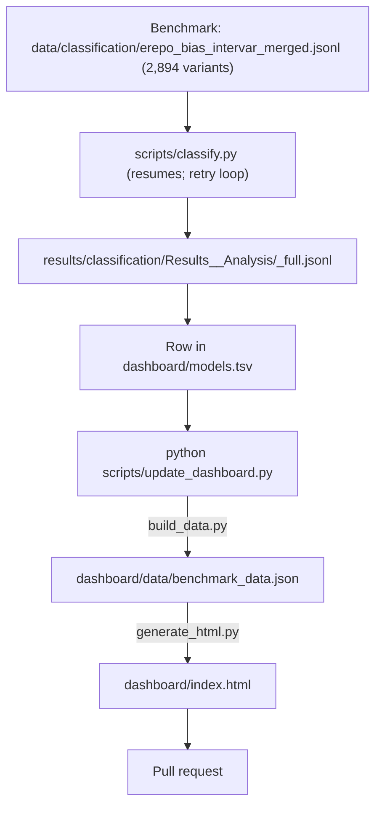

# RareDx Bench: Adding or Updating a Classification Model

Every model update goes through a pull request: run the model, register its
results, rebuild the dashboard, and open the PR. The dashboard
(`dashboard/index.html`) is a static page built from the committed results; it
reads nothing at view time.

---

## 1. Pipeline



`build_data.py` scores every model against the ClinGen expert classification
of the 2,894 benchmark variants in that file (how they were chosen:
[dashboard/README.md](dashboard/README.md#benchmark-variant-set)). A run on that
file covers exactly the variants the dashboard ranks.

---

## 2. Run the model

Set up `.env` from `.env.example` (API token), then run `classify.py`.
It resumes: re-running the same command skips variants already in the output
file, so a loop retries anything dropped by rate limits or network errors and
stops once nothing is left.

```bash
MODEL="<provider/model-id>"                       # e.g. anthropic/claude-sonnet-5-5
OUT="results/classification/Results_<Model>_Analysis/<model>_full.jsonl"
mkdir -p "$(dirname "$OUT")"
set -a; source .env; set +a

for pass in 1 2 3 4 5 6 7 8 9 10; do
  python3 -u scripts/classify.py \
    --input data/classification/erepo_bias_intervar_merged.jsonl \
    --output "$OUT" --model "$MODEL" --concurrency 5 | tee /tmp/aiva_pass.log
  grep -q "Nothing left to classify" /tmp/aiva_pass.log && break
  sleep 30
done
```

A full run takes many hours. To keep it running with the laptop lid closed or
the terminal gone, start it under `caffeinate -is` and `nohup` (macOS), or on
a server.

### Monitor

```bash
python3 scripts/ledger.py --model "$MODEL"   # classified so far, and what is left
python3 scripts/retry_errors.py "$OUT"       # re-run rows that ended in an API error
```

---

## 3. Register the results

Add one row to `dashboard/models.tsv` (key, display name, provider, method,
path to the results file, format, section). The columns are described in
[dashboard/README.md](dashboard/README.md#adding-a-model). Results files under
`results/classification/` are tracked by git automatically; JSON and JSONL
elsewhere are ignored.

To hide a model, set its `status` to `removed` in `models.tsv` instead of
deleting the row.

---

## 4. Rebuild the dashboard

```bash
python3 scripts/update_dashboard.py
```

This runs `dashboard/build_data.py` (scores every registered model) and
`dashboard/generate_html.py` (writes `dashboard/index.html`). Preview it by
opening `dashboard/index.html`, or:

```bash
python3 -m http.server 8050 --directory dashboard   # http://localhost:8050
```

---

## 5. Open the pull request

```bash
git checkout -b add-<model>
git add dashboard/models.tsv dashboard/data/benchmark_data.json dashboard/index.html \
        results/classification/Results_<Model>_Analysis/<model>_full.jsonl
git commit -m "feat(benchmark): add <Model> results"
git push -u origin add-<model>
```

**macOS note:** if git fails with an `mmap` error on a large results file,
strip the quarantine attribute first:
`xattr -d com.apple.provenance results/classification/Results_<Model>_Analysis/<model>_full.jsonl`.
